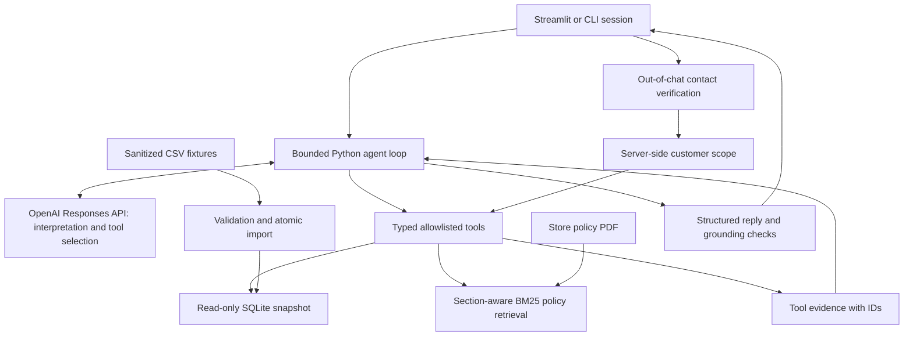

# Empório da Música — Artefact AI Engineer challenge

A Python customer-service prototype for a fictional musical-instrument store in Campo
Grande, Brazil. The assistant uses a language model to choose constrained tools, reads
operational facts from SQLite imported from the supplied CSVs, and retrieves cited policy
sections from the store's actual eight-page manual. Streamlit provides the chat interface;
a CLI is available for the same agent.

Customer dialogue is primarily Brazilian Portuguese, with English supported by the model
and bilingual retrieval aliases. Technical documentation is in English.

## Run locally

Requires Python 3.11+; the exact tested environment is Python 3.12 on Linux. Launch commands
from the repository root. No private academic references or original challenge PDF are needed.

```bash
git clone https://github.com/unlimitedabe/artefact-ai-engineer.git
cd artefact-ai-engineer
python3 -m venv .venv
source .venv/bin/activate
python -m pip install -e '.[dev]'
cp .env.example .env
emporio load
streamlit run app.py
```

On Debian/Ubuntu, if creating a venv fails because `ensurepip` is absent, install the
matching `python3-venv` package first. On Windows activate `.venv\Scripts\Activate.ps1`
instead. The normal install resolves versions compatible with your Python/platform. To
reproduce the exact validated CPython 3.12 Linux dependency set, replace the pip install
command with `python -m pip install -r requirements.lock -e .`.

Without a key, choose **Demonstração offline** in the sidebar, or set `AGENT_MODE=demo` in
`.env`. This is an explicitly limited deterministic demonstration, not a language model.
For example, ask `Quanto custa o Takamine GD20?`, followed by `E ele no PIX?`.

For real model operation, set `OPENAI_API_KEY` in `.env`, select **IA via API**, and ask
the same questions. Obtain your own API key through the OpenAI API platform, configure
API billing/credits and model access, and keep the key out of Git and the chat. A ChatGPT
subscription must not be assumed to provide this application's API access or billing.
The application never uses Codex or browser-login credentials as model credentials.

```bash
emporio chat                 # real configured model
emporio chat --demo          # limited offline demonstration
python scripts/smoke_openai.py  # three opt-in real API turns; may incur API charges
```

The CLI supports `/verify`, `/logout`, `/clear` and `/quit`. Verify only through the
sidebar form or `/verify`, never by posting contact details into the conversation.

Use the **synthetic** identity `customer03@example.invalid`, phone `00000000003`, to
inspect order 1 in the published fixtures. Order 2 belongs to a different synthetic
customer and returns the same non-disclosing result as a nonexistent order.

## Features and evidence

- Product search by name, category, inclusive price range and actual availability; product
  details include JSON specifications, list price, effective campaign price and stock.
- Campaigns use supplied active flags and exact cent arithmetic; no inferred validity dates.
  Quotes enforce PIX non-stacking and installment tiers from the manual.
- Session-scoped order lookup after contact matching, with no model-visible customer selector.
- Policy retrieval with section/page references for hours, address, payment, delivery,
  returns, warranty and store scope. Preliminary return checks ask for missing facts.
- Multi-turn context, bounded tool execution, invalid-input handling, grounding checks,
  provider-failure fallback and polite redirection for unrelated requests.
- Five [executed offline conversations](examples/), automated tests and an API smoke script.

**Validation:** 89 tests passed, 0 failed in the full local suite, including Streamlit
interaction tests. Ruff checks passed. Real remote LLM end-to-end validation was **not
performed**, because no API key was available. SDK integration tests use a mocked HTTP
transport; example conversations use the labeled offline provider. These are different
levels of evidence, not a claim of verified production LLM quality. See [evaluation](docs/evaluation.md).

The pinned dependencies, CSV loading and all tests were also checked in a second clean
virtual environment. The Streamlit server started successfully and returned `ok` from
its local HTTP health endpoint.

## Architecture and agent approach



This is a hybrid tool-using agent: the LLM decides whether to retrieve operational data,
policy text, or both. Application code validates arguments and executes all queries and
monetary calculations. It uses no unrestricted SQL agent and performs no business writes.
The explicit loop is small enough to inspect without LangChain, LangGraph, an agent SDK,
MCP servers or microservices. No model training is needed for these changing store facts.

Python, SQLite, Pydantic, pypdf, the OpenAI Python SDK, Streamlit and Pytest keep the system
locally reproducible. SQLite supports joins and transactional validation with no service
to provision. Pydantic independently enforces tool contracts, even if a provider returns
malformed arguments. The Streamlit UI is deliberately focused on the agent rather than
visual customization.

### Model/provider

The default is OpenAI `gpt-4.1-mini`, configurable using `OPENAI_MODEL`. It supports the
Responses API, function calls and structured output; see the [official model documentation](https://developers.openai.com/api/docs/models/gpt-4.1-mini)
and [function-calling guide](https://developers.openai.com/api/docs/guides/function-calling).
It is a compact general-purpose baseline for this bounded task, not a claim of being the
latest or empirically optimal model. Provider choice has not been benchmarked here.

The adapter supplies strict JSON schemas, `parallel_tool_calls=False`, `store=False`, a
30-second request timeout, one SDK retry and a 1,600-output-token limit. The default five
model rounds allow several tool calls and a final answer. Authentication, access, billing
and model availability must be confirmed with a real key. `store=False` avoids application
use of server-side conversation storage; it does not assert zero provider-side retention.

### Operational retrieval

`emporio load` validates schemas, required fields, types, enum values, primary/foreign
keys, JSON specifications, date ordering and nonnegative money/stock, then atomically builds
SQLite. Source hashes detect changed CSVs on initialization; failed builds preserve the
previous file. The running UI caches resources, so after changing source files run the
loader and restart Streamlit. The assistant uses parameterized, read-only queries only.

Tools are `search_products`, `get_product_details`, `get_promotions`, `get_order_status`,
`search_store_policies`, `quote_product`, and `assess_return_request`. Nullable parameters
are explicitly required in schemas. Product searches normalize accents and require all
query tokens, sort by effective price, and report truncation. For English product types,
the model should map the query to Portuguese category labels. Prices are integer cents;
discounts use Decimal half-up rounding. Quotes distribute installment rounding remainders
without changing the total. Orders retain their authoritative historical totals.

See the [data audit](docs/data_audit.md) for row counts, missing values, relationships,
anomalies and specific policy ambiguities. The snapshot is not a live inventory, order,
carrier, payment or complaint system. No claim of current external synchronization is made.

### Policy retrieval and theoretical justification

Layout-aware PDF extraction preserves table text. Numbered policy sections become chunks;
sections spanning pages retain their full page list. BM25 ranks normalized lexical terms,
weights discriminative terms through inverse document frequency and adjusts for document
length. A small bilingual alias dictionary improves terms such as `return` → `arrependimento`.
Explicit cross-references append return exclusions and campaign/payment rules so a short
retrieval result does not omit related conditions. Unknown terms can return no matches.

For this eight-page manual, lexical retrieval avoids embedding downloads, another API
dependency and vector database infrastructure. It is fast, explainable and works offline.
TF-IDF cosine is a reasonable alternative; embeddings would offer semantic matching beyond
known aliases but introduce model/version and evaluation work. On a 12-query, in-sample
diagnostic, expected-section hit@3 was 75% for literal overlap, 75% for TF-IDF and 100% for
the implemented BM25/alias package. This small check does not prove general superiority.
Embeddings were considered conceptually, not experimentally benchmarked.

The local academic lectures on vector representations (TF-IDF/cosine), word embeddings,
LLMs/RAG/fine-tuning and tool-using agents informed these choices. Relevant reviewed topics
include the vector-representation lecture pp. 13–15, embeddings pp. 8 and 20, LLM/RAG
lecture pp. 38–44 and 58–60, and agents lecture pp. 9, 22–23 and 33–34. These private
materials are supplementary background and are not required to reproduce the project.

The FYRTRACK background involved deterministic classification, TF-IDF and a supervised
MLP with confidence fallbacks. Its transferable lesson here is to keep business facts and
calculations deterministic and evaluate observed failures. FYRTRACK is not presented as
previous implementation of LLM agents, RAG or function calling. No TF-IDF classifier, MLP,
fine-tuning, synthetic-training pipeline or embedding model is implemented in this agent;
the small TF-IDF code is a retrieval comparison baseline only.

### Prompting, grounding and conversation memory

The system prompt defines the store persona, language, source routing, privacy boundary,
uncertainty handling, policy caveats and prohibition on unsupported commitments. Source
text is evidence, never an instruction. The model receives tool outputs and returns a
structured answer with evidence IDs. Store answers without successful current-turn tool
evidence and BRL amounts absent from the cited evidence are rejected; the loop may retry
within its bound, then return a safe fallback. Quotes are calculated in Python.

This evidence check is intentionally modest: it does not semantically verify every sentence,
prove that each amount belongs to the correct product, or guarantee resistance to every
prompt injection. Model behavior must still be evaluated with real API conversations.
Server-enforced tool allowlists and customer scoping remain effective independently of
prompt compliance. Return checks are preliminary and never execute refund/return operations.

Each session keeps up to eight complete turns, including tool calls/results, only in process
memory. Whole turns are evicted together, avoiding orphaned tool outputs. Current-turn
facts must be retrieved again. There is no cross-session persistence or semantic summary;
old preferences may be forgotten. Clearing chat resets history. Verifying/changing identity,
logging out or switching model/demo mode clears history to avoid cross-account reuse.

## Configuration

| Variable | Default | Purpose |
| --- | --- | --- |
| OPENAI_API_KEY | empty | API key for real model mode; never required by unit tests |
| OPENAI_MODEL | gpt-4.1-mini | Responses-compatible model with function calls and structured output |
| DATA_DIR | fixtures/public | Directory containing all six validated CSV files |
| POLICY_PDF | data/políticas_da_loja.pdf | Authoritative supplied store manual |
| DATABASE_PATH | runtime/store.sqlite3 | Generated local snapshot, ignored by Git |
| MAX_TOOL_ROUNDS | 5 | Maximum model rounds per turn, range 1–10 |
| MAX_HISTORY_TURNS | 8 | Complete session turns kept, range 1–20 |
| AGENT_MODE | openai | `openai` for real API or `demo` for limited offline scenarios |

The published fixtures are the default. To inspect local originals, set `DATA_DIR=data`
and use a separate `DATABASE_PATH`. Originals contain plausible personal contacts: use only
authorized local handling and avoid sending them to a model provider. The paid smoke script
always selects the sanitized fixture instead of original records.

To recreate public fixtures if the original challenge files are present locally:

```bash
python scripts/prepare_public_data.py --source data --destination fixtures/public
emporio load
```

## Project structure

```text
app.py                        Streamlit chat and out-of-chat verification
emporio/
  agent.py, prompts.py        Bounded orchestration, evidence checks and persona
  provider.py, demo.py        Real Responses adapter / labeled offline provider
  tools.py                    Strict tool schemas and deterministic calculations
  ingest.py, store.py         CSV validation/import and read-only data access
  policies.py                 Section extraction, BM25 retrieval, return precheck
  session.py, config.py       Verification state and environment settings
  bootstrap.py, cli.py        Shared wiring and command-line entry point
fixtures/public/              Sanitized, runnable relational CSV fixtures
data/políticas_da_loja.pdf    Supplied fictional store policy knowledge source
tests/                        Offline data/tool/agent/provider/UI tests
examples/                     Five executed offline conversations
scripts/                      Fixture generation, retrieval evaluation and API smoke
docs/                         Requirement interpretation, data audit, evaluation
requirements.lock            Exact validated CPython 3.12 Linux dependency versions
```

## Tests and examples

```bash
pytest -q
ruff check .
ruff format --check .
python scripts/evaluate_retrieval.py
python scripts/generate_examples.py
python scripts/audit_publication.py
```

Tests make no paid calls. The SDK is exercised with a mocked HTTP transport; the UI is
tested with Streamlit AppTest. GitHub Actions also runs the offline suite on Python 3.11
and 3.12; consult the actual workflow results rather than assuming CI has passed.

The five conversations cover [guitar search](examples/01_product_search.md),
[price and a contextual PIX follow-up](examples/02_price_and_pix.md),
[location and hours](examples/03_location_and_hours.md),
[return policy conditions](examples/04_return_policy.md), and
[scoped order access](examples/05_verified_order.md). They capture actual execution of the
offline pipeline and include tool arguments and evidence summaries. They do not demonstrate
a real model choosing tools or a connection to a live store system.

## Security, privacy and limitations

Original customer contacts, original CSVs, `.env`, credentials, local authentication files,
the challenge PDF and all academic PDFs are excluded from Git. Published customers use
synthetic names/cities, deliberately invalid phone prefixes, reserved `example.invalid`
emails and `DEMO` tracking identifiers. Free-text order notes are sanitized. The public
fixture is functional without access to the originals.

Order queries require both email and phone to match outside the model, then use a bound
customer ID and parameterized predicates. There is no customer-listing tool. Missing and
other-customer orders have identical errors. Five failed identity attempts lock the current
session; restarting a session can reset that limit. **This is a prototype check using known
contact details, not production authentication.** Public demo credentials prove nothing
about a real user's identity. A real deployment needs authenticated accounts or OTP,
server-side rate limits, auditing and an appropriate data-protection review.

User messages and retrieved data supplied to real mode are sent to the configured API
provider. The app does not intentionally log chat transcripts or API secrets to disk, but
local database files and in-memory sessions still contain whichever dataset you select.
Do not expose this prototype publicly with real customer data. The application has no
authorization to reserve inventory, send messages, register tickets, refund payments or
change orders, and it does not claim to have performed those actions.

Known limitations include a historical snapshot, missing actual receipt dates/channels,
no holiday calendar or carrier integration, small lexical alias coverage, no full semantic
grounding validator, no empirical real-model evaluation without credentials, and no
production authentication. The quote/precheck rules implement this specific version of
the manual; updating the PDF requires reviewing those rules and rerunning tests.
Unclear policy cases require the store team. See [documented assumptions](docs/data_audit.md).

With more time, prioritize real-model regression conversations with human rubrics,
held-out bilingual retrieval cases, measuring answer faithfulness/tool selection/cost,
production identity and rate limiting, monitored inventory/order adapters, and semantic
retrieval only if measured recall failures justify it. A larger model, fine-tuning, a vector
database and multi-agent orchestration are not prerequisites for this small assessment.

## AI-assisted development disclosure

OpenAI Codex was used as a coding assistant under human supervision for implementation,
testing, code review and documentation. The developer is responsible for reviewing the
solution and deciding what to submit. The checks described here were executed by the
coding assistant; this statement does not claim that a human has already verified the
code, generated answers or evaluation results. The original challenge permits coding
assistants when their use is disclosed.

Submit the public repository link personally using the instructions and deadline in the
recruitment email. No Google Form submission or email sending is part of this application.
